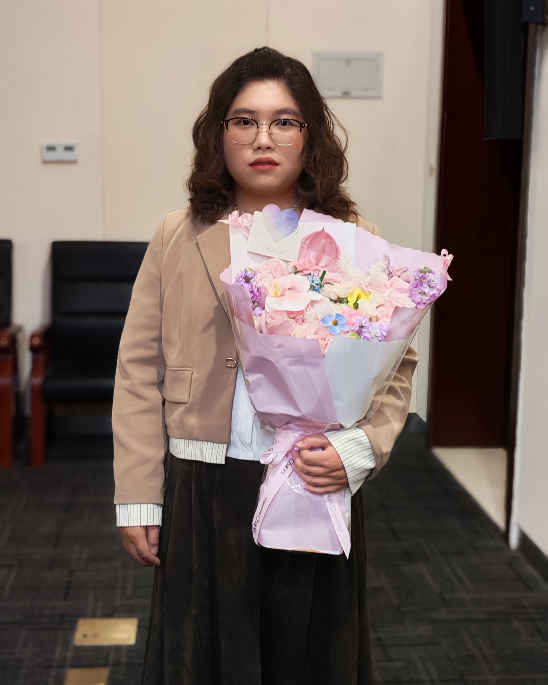
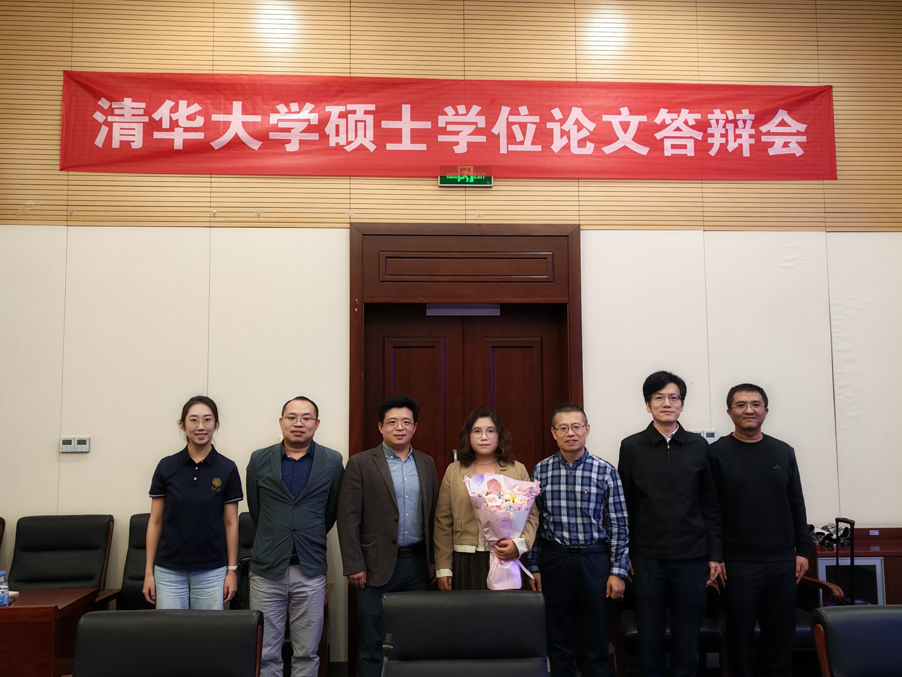
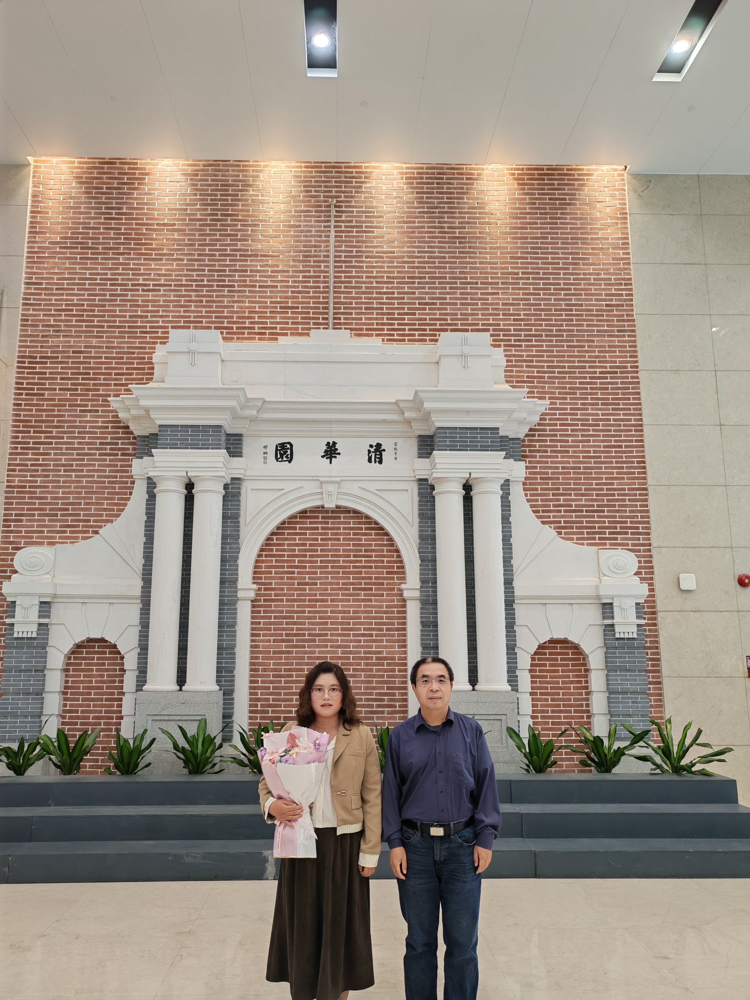
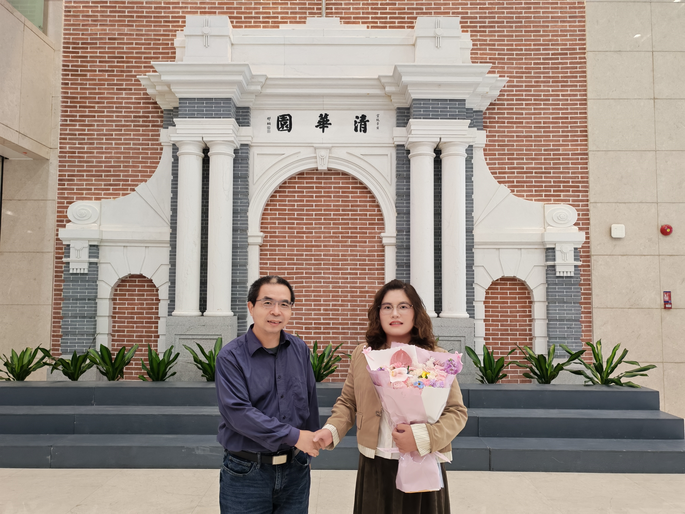

# 硕士毕业答辩 · 一段旅程的终点，也是新的起点

2026年11月，我顺利通过了清华大学硕士学位论文答辩。

答辩的最后，答辩委员会主席宣布：

> “胡齐齐同学，经答辩委员会表决一致通过，同意授予硕士学位。”

话音落下，全场响起了掌声。

那一刻，我感到由衷的喜悦与释然。过去一年多的努力、焦虑、尝试与坚持，终于在这一刻有了一个圆满的结果。

这不仅意味着硕士阶段的学习与科研告一段落，也意味着人生即将进入一个新的阶段。

  

---

## 一、回望来时路：在探索中成长

回顾硕士阶段的经历，从最初接触陌生的研究方向，到逐渐独立开展科研工作，再到完成论文发表与毕业答辩，这一路并非总是一帆风顺。

科研中有过困惑，也经历过反复尝试和推倒重来的过程。但正是这些经历，让我逐渐学会独立思考、面对不确定性，以及在困难中寻找解决问题的方法。

相比最终取得的成果，我更加珍惜这个过程中自身的变化。

从本科到硕士，从青岛到深圳，我接触了不同的人、不同的环境，也逐渐形成了对科研、工作和生活更清晰的认识。

> **成长或许并不意味着所有问题都有了答案，而是面对未知时，拥有了更多从容与勇气。**

  

---

## 二、心怀感激：感谢所有同行的人

能够顺利走到今天，离不开许多人的支持与帮助。

感谢导师和各位老师在科研与学习中的指导，感谢实验室的师兄师姐、同门和朋友们一路以来的陪伴、鼓励与帮助，也感谢家人始终如一的理解与支持。

硕士阶段最珍贵的收获，不仅是知识与能力的积累，还有在这段旅程中遇见的人，以及那些共同经历过的时光。

当然，也想认真地感谢自己。

感谢自己在迷茫时没有轻易放弃，在遇到困难时仍然愿意继续尝试，也感谢自己一步一步走到了今天。

> **感谢一路同行的大家，也感谢那个始终努力向前的自己。**

  
  

---

## 三、走向下一站：关于未来的选择

随着硕士阶段接近尾声，我也开始认真思考未来的职业方向。

相比继续攻读博士学位，我目前更倾向于走向实际工作，在真实的组织与项目中积累经验、提升能力。

现阶段，我希望寻找一份相对稳定、具有长期发展空间的工作，重点考虑国有企业、中央企业、科研院所、设计院及其他泛体制内单位。

在工作地点上，我更倾向于回到湖南，尤其是长沙。一方面，希望离家人更近；另一方面，也期待在一座适合自己的城市中，逐渐建立稳定而充实的生活。

我知道，毕业并不意味着未来的道路已经清晰。求职、职业发展与人生选择，仍然存在许多未知。

但相比过去，我已经更加了解自己想要什么，也更愿意为自己的选择承担责任。

---

## 结语

硕士毕业答辩的顺利通过，为这段求学旅程画上了一个圆满的句号。

回望过去，有努力，也有遗憾；有收获，也有成长。那些曾经觉得漫长而艰难的日子，如今都成为了人生中值得珍藏的记忆。

很幸运，能够在清华园度过这段时光，也很开心，自己最终没有辜负这段经历。

**感谢所有帮助过我的人，感谢一路坚持的自己。**

**硕士阶段，圆满收官。下一段旅程，继续努力。**
